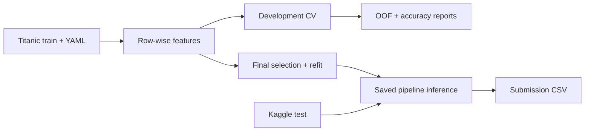

# Titanic

Titanic survival predictions.

**Best recorded Kaggle public accuracy: [0.77272](docs/EXPERIMENTS.md#source-and-matching-boundary)**,
achieved by both my fixed and tuned logistic-regression submissions.



## Recorded results

Local CV is **mean accuracy (%) ± fold SD (percentage points)**. Fixed models use
5-fold CV; tuned models use 5 outer / 3 inner folds on the same 712 development rows
(idk, maybe nested CV is not needed here).

| Model / setup | Optuna trials / search | Local CV, % ± SD | Public accuracy |
|---|---:|---:|---:|
| Logistic regression (baseline) | 0 | 82.72 ± 2.15 | **0.77272** |
| Logistic regression + Optuna | 60 | 82.30 ± 2.44 | **0.77272** |
| Gradient boosting (baseline) | 0 | 82.86 ± 1.71 | 0.76076 |
| Gradient boosting + Optuna | 20 | 83.00 ± 2.10 | 0.75837 |
| XGBoost + Optuna | 60 | 83.56 ± 3.24 | 0.75837 |
| XGBoost ensemble (5 models) | 60 | 82.87 ± 2.62 | 0.75598 |
| LightGBM + Optuna | 60 | 82.58 ± 2.81 | 0.76076 |
| K-nearest neighbors + Optuna | 60 | 81.32 ± 3.13 | 0.75837 |

[result snapshot](docs/experiment-results.json), [experiment notes](docs/EXPERIMENTS.md).


CV and public scores are measured on different data.

## Run and configure

Model examples are in [configs/](configs/). Copy one to `config.yaml`, e.g.:

```bash
cp configs/config_catboost.yaml config.yaml
```

Optuna is off in the examples; set `tuning.enabled: true` to use the included search space.

DNN examples: [MyModel](configs/config_dnn.yaml) and [MyModelEmb](configs/config_dnn_embedding.yaml).
`custom/Name` loads a PyTorch model from `src/models.py`; input sizes are inferred automatically.

Place the original Titanic CSVs at `data/titanic/train.csv` and `data/titanic/test.csv`, then edit
[config.yaml](config.yaml) and run:

```bash
uv sync --python 3.14
uv run python run.py
```

Each run creates `artifacts/<exp_name>/<UTC timestamp>/`; earlier runs are preserved.

| Setting | Purpose / default |
|---|---|
| `base.exp_name`, `base.seed` | Run label and existing seed `0xFACED` |
| `run.mode` | `full`, `evaluate`, `train`, or `predict` |
| `run.model_path` | Saved `model.joblib` or `model.pt`, required for `predict` |
| `data.train_path`, `data.test_path` | CSV locations |
| `features.feature_set` | `base_title_family` by default |
| `preprocessing` | One-hot encoding; enable scaling for logistic regression and KNN |
| `model.name`, `model.params` | Classifier and native constructor parameters |
| `ensemble` | Member count, soft/hard voting or stacking, OOF folds and meta-model |
| `validation` | Development fraction, evaluation folds and inner search folds |
| `tuning` | Optuna enable flag, trial budget and parameter distributions |
| `training`, `loss`, `optimizer`, `scheduler` | DNN epochs, batch size, device and training settings |
| `metric.name` | `accuracy`, the supported primary metric |
| `output.dir` | `artifacts` |

`full` evaluates, fits the final model, and writes predictions. `evaluate` only
runs CV; `train` fits the final model, with parameter selection if enabled.
For inference without training:

```yaml
run:
  mode: predict
  model_path: artifacts/gb_v1/<run_id>/model.joblib
```

To change the model, edit `model.name` and `model.params`. If Optuna is enabled,
replace `tuning.search_space` with parameters for that model too.

For seed ensembles, set `ensemble.n_models` and choose `soft`, `hard` or `stacking`
in `ensemble.method`. Members use the same model family. KNN and custom DNNs use one model.

Default features: `Pclass`, `Age`, `SibSp`, `Parch`, `Fare`, `Sex`, `Embarked`,
plus `Title` and `FamilySize`. Preprocessing is fitted inside each training fold.

## Outputs

Open `summary.md` in the run folder for accuracy and final parameters.
`metrics.json` has the same scores. CV accuracy is the evaluation result;
the final Optuna score is used for parameter selection.

`submission.csv` is ready for Kaggle. Classical models use `model.joblib`;
DNNs use `model.pt` plus `preprocess.joblib` in the same run folder.

Earlier experiments are in `notebooks/`.
