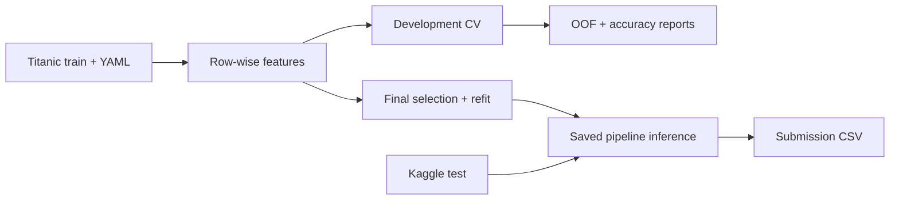
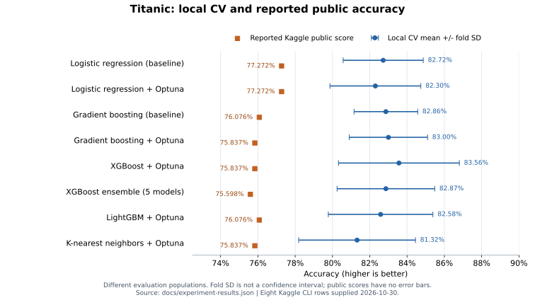

# Titanic: a configurable classical ML pipeline

Predict passenger survival with a small, explicit sklearn pipeline. Supported
models are `LogisticRegression`, `GradientBoostingClassifier`, `CatBoostClassifier`,
`XGBClassifier` and `LGBMClassifier`. One YAML file controls features, evaluation,
Optuna and a single model or seed ensemble. Learned preprocessing stays inside
the folds; final selection and full-data refitting are separate from evaluation.

**Best reported Kaggle public accuracy: [0.77272](docs/EXPERIMENTS.md#source-and-matching-boundary)**, shared by the fixed and tuned
logistic-regression submissions. The submitted boosting runs and five-seed
XGBoost ensemble did not exceed that baseline. These are reported public scores,
not private-test results or evidence of statistical significance.



Evaluation and final fitting are separate. Optuna, when enabled, selects
parameters using development rows; the final pipeline is then fitted afresh
on all labeled rows. Every evaluation fit includes its own preprocessing.
Kaggle test is read only for inference. The current config runs a single tuned
LightGBM; this is the active experiment, while logistic regression retains the
highest public score in the supplied submission snapshot.

## Recorded results

Accuracy is higher-is-better. Local values below are **percent mean ± fold SD in
percentage points**; public scores are fractions on the 0–1 scale. Fixed models
use five-fold CV; tuned models use five outer / three inner folds on the same
712 development rows. SD is not a confidence interval.

| Experiment | Optuna trials / search | Local CV, % ± SD | Public accuracy | Submission ID |
|---|---:|---:|---:|---:|
| `lr_v1` | 0 | 82.72 ± 2.15 | **0.77272** | 57764095 |
| `lr_v1_tuned` | 60 | 82.30 ± 2.44 | **0.77272** | 57764463 |
| `gb_v1` | 0 | 82.86 ± 1.71 | 0.76076 | 57764134 |
| `gb_v1_optuna` | 20 | 83.00 ± 2.10 | 0.75837 | 57760541 |
| `xgb_1_tuned` | 60 | 83.56 ± 3.24 | 0.75837 | 57797886 |
| `xgb_5seeds_tuned` | 60 | 82.87 ± 2.62 | 0.75598 | 57797655 |
| `lgbm_1_tuned` | 60 | 82.58 ± 2.81 | 0.76076 | 57798445 |

Public scores were supplied by the project author from Kaggle CLI output on
2026-10-30; they were not fetched again for this documentation update. Runs are
associated by experiment description; uploaded file bytes were not verified.
Private scores were blank. Exact run IDs, original submission descriptions,
configurations, per-fold scores and local CSV hashes are retained in the
[result snapshot](docs/experiment-results.json) and explained in the
[experiment notes](docs/EXPERIMENTS.md).



The figure compares different evaluation populations. Local scores come from
saved CV reports and OOF predictions.

Optuna did not improve the reported logistic-regression public score. The
five-seed XGBoost procedure recorded lower CV and public accuracy than the single
XGBoost run, but both were tuned separately, so this is not a fixed-parameter
comparison of averaging alone. Two additional GB searches reached 83.57% and 83.85%
local CV; no public scores were supplied for them. These observations do not
identify the cause of the CV-to-public gap or establish a universal model ranking.

## Run and configure

Use Python 3.14+ and the environment declared in [pyproject.toml](pyproject.toml).
The dependency file gives version lower bounds; saved run versions are included
in the result snapshot. Place the original
Titanic CSVs at `data/titanic/train.csv` and `data/titanic/test.csv`, then edit
[config.yaml](config.yaml) and run:

```bash
.venv/bin/python run.py
```

There are no CLI options. The script finds the root config and resolves relative
data/output/model paths from the project root, even when the current working
directory is elsewhere. Absolute paths also work, including Kaggle input paths.
Each run creates `artifacts/<exp_name>/<UTC timestamp>/`; earlier runs are preserved.

| Setting | Purpose / default |
|---|---|
| `base.exp_name`, `base.seed` | Run label and existing seed `0xFACED` |
| `run.mode` | `full`, `evaluate`, `train`, or `predict` |
| `run.model_path` | Saved `model.joblib`, required for `predict` |
| `data.train_path`, `data.test_path` | CSV locations |
| `features.feature_set` | `base_title_family` by default |
| `preprocessing` | One-hot encoding; scaling enabled for the logistic baseline |
| `model.name`, `model.params` | Classifier and native constructor parameters |
| `ensemble` | Member count, soft/hard voting or stacking, OOF folds and meta-model |
| `validation` | Development fraction, evaluation folds and inner search folds |
| `tuning` | Optuna enable flag, trial budget and parameter distributions |
| `metric.name` | `accuracy`, the supported primary metric |
| `output.dir` | `artifacts` |
| `comparison.runs` | Run folders to compare using the separate script |

`full` evaluates, fits the final model, and writes predictions. `evaluate` only
produces evaluation artifacts; `train` only selects parameters if requested and
fits the final model. For inference without training, use:

```yaml
run:
  mode: predict
  model_path: artifacts/gb_v1/<run_id>/model.joblib
```

Inference loads the feature specification and fitted preprocessing from the
artifact. Current YAML model/feature/search settings do not rebuild or refit it;
`data.test_path` and `output` still control input and destination. `inference.json`
records the model and training configuration actually used.

<details>
<summary>Configure the logistic-regression baseline</summary>

For a LogisticRegression baseline, replace the `model` block and enable scaling:

```yaml
model:
  name: LogisticRegression
  params:
    C: 1.0
    max_iter: 2000
    random_state: ${base.seed}
preprocessing:
  encoding: onehot
  scale: true
```

Use a different `base.exp_name`, for example `lr_v1`. If enabling Optuna for this
model, also replace `tuning.search_space` with:

```yaml
search_space:
  C: {type: float, low: 0.001, high: 100, log: true}
```

</details>

Search keys are native model parameters; code supplies the sklearn nesting and
applies a shared setting to all ensemble members. Replace the whole search space
when changing model families. Saved run configurations and final effective
parameters are different: Optuna replaces searched settings during final selection.

The checked-in configuration currently uses `LGBMClassifier`, one model and
60 Optuna trials per search. It starts with 300 boosting rounds, learning rate
0.05, at most 15 leaves and depth 4. Its search varies `num_leaves` while keeping
depth fixed, and `subsample_freq: 1` activates row subsampling. Native LightGBM
log loss is distinct from the accuracy optimized by project CV.

LightGBM uses `n_jobs: 1` in this local configuration because native crashes were
observed with four threads in the mixed-library macOS environment. This is a local
environment workaround, not a general restriction of LightGBM.

### Simple seed ensembles

`ensemble.n_models: 1` keeps a single model. Set it to `5` to train five copies
of `model.name` with the same parameters and distinct, reproducible seeds derived
from `base.seed`. `ensemble.method` selects soft voting, hard voting or stacking.
The default is `soft`, the equal mean of class probabilities. All
copies train on the complete training portion of each fold; final copies train
on all labeled rows. This is an ensemble of one model family, with shared
parameters, rather than a mixture of different model classes.

<details>
<summary>CatBoost and XGBoost configuration examples</summary>

For five CatBoost models, replace the corresponding blocks in `config.yaml`:

```yaml
base:
  exp_name: catboost_5seeds
  seed: 0xFACED
  run_kind: full
model:
  name: CatBoostClassifier
  params:
    iterations: 300
    depth: 4
    learning_rate: 0.05
    l2_leaf_reg: 3.0
    thread_count: 1
    random_state: ${base.seed}
ensemble:
  n_models: 5
  method: soft
preprocessing:
  encoding: onehot
  scale: false
tuning:
  enabled: false
  n_trials: 20
  search_space: {}  # Replace with model-specific ranges before enabling Optuna.
```

For five XGBoost models, use the same ensemble/preprocessing settings and replace
the model block:

```yaml
model:
  name: XGBClassifier
  params:
    n_estimators: 300
    max_depth: 3
    learning_rate: 0.05
    subsample: 0.8
    colsample_bytree: 0.8
    objective: binary:logistic
    eval_metric: logloss
    tree_method: hist
    n_jobs: 1
    random_state: ${base.seed}
```

Use a separate experiment name, such as `xgb_5seeds`. These are starting settings,
not measured improvements. XGBoost's row/column subsampling makes different seeds
useful; changing only the seed can otherwise produce identical models. CatBoost
uses the existing numeric imputation and one-hot representation here; native
categorical handling is not enabled. CatBoost's verbose output and auxiliary file
writing are disabled by default.

</details>

The implementation uses sklearn's
[VotingClassifier](https://scikit-learn.org/stable/modules/generated/sklearn.ensemble.VotingClassifier.html)
and [StackingClassifier](https://scikit-learn.org/stable/modules/generated/sklearn.ensemble.StackingClassifier.html).
No extra model wrapper or dependency is added. All three methods use the same
member seeds for a given `base.seed` and ensemble size. CV scores the complete
ensemble, not an average of member accuracies. The saved pipeline includes all
members and the stacking meta-model, so predict mode needs only `model.joblib`.
Earlier soft-voting artifacts saved with BaggingClassifier remain loadable;
new runs use the common seed assignment for all three methods.

| `ensemble.method` | Prediction rule | `p_survived` |
|---|---|---|
| `soft` | Class with the highest mean probability | Mean survival probability |
| `hard` | Majority of predicted class labels | Empty; hard voting has no probability output |
| `stacking` | Meta-model combines base probabilities | Meta-model's survival probability |

For hard voting, set `method: hard`; an odd model count such as five avoids tied
votes. With an even count, a tie is resolved in favor of the smaller class label
(`0`). Accuracy is still available. Prediction and OOF CSVs retain `p_survived`
with empty values; these are not replaced with vote fractions or label values.

For stacking, use:

```yaml
ensemble:
  n_models: 5
  method: stacking
  stacking_folds: 3
  meta_model:
    name: LogisticRegression
    params:
      C: 1.0
      max_iter: 2000
```

The meta-model learns from OOF probabilities of the base models. Preprocessing
is inside each base pipeline, so imputers, scalers and encoders are fitted
again inside each stacking fold. Base models are then available fitted on the
complete parent training portion for inference. Raw features are not passed to
the meta-model. These OOF folds are required even with `tuning.enabled: false`;
`stacking_folds` does not replace the outer CV used to evaluate the ensemble.
Three stacking folds require four base fits per member for each ensemble fit,
including the refit on the complete parent training portion. Stacking of similar
seed copies may add little information; improvement must be measured on CV.

Optuna works with all three methods: each trial selects one shared parameter set
for all members and scores the complete ensemble's predictions. Keep native
parameter names in `tuning.search_space`; code applies the same sampled value
to every member. Stacking meta-model settings stay fixed in `ensemble.meta_model`.
For example, replace the entire search space before enabling tuning for CatBoost:

```yaml
search_space:
  depth: {type: int, low: 3, high: 6}
  learning_rate: {type: float, low: 0.02, high: 0.1, log: true}
  l2_leaf_reg: {type: float, low: 1.0, high: 10.0, log: true}
```

Set a deliberate `tuning.n_trials` budget: soft/hard voting fits five models each
time, and stacking adds its OOF fits.
`summary.md` shows ensemble size and actual final member seeds; `training.json`
and `metrics.json` store them under `ensemble`. `parameters` contains shared base
model parameters; member seeds are recorded separately.

## Features and evaluation

The default representation uses `Pclass`, `Age`, `SibSp`, `Parch`, `Fare`, `Sex`,
`Embarked`, plus two row-wise features from the original notebook: `Title` extracts
an honorific from `Name`, and `FamilySize` counts the passenger and accompanying
relatives. Both are computed identically for train and test. Other existing
feature sets remain available through `features.feature_set`; additional features
are not generated automatically.

Numeric missing values use a median imputer. Categorical missing values use a
most-frequent imputer followed by an encoder that handles unseen categories.
Scaling is optional and enabled for the logistic baseline. Every learned
transform lives inside the sklearn pipeline and is fitted on that fold's
training rows. Row-wise feature extraction itself learns no statistics.

The original stratified 80/20 split and seed are preserved: 712 development and
179 holdout rows for the supplied train CSV. The previously viewed holdout is
excluded from evaluation and tuning. Validation uses row-level stratification;
generalization to entirely new families or tickets would require a separate
group-based protocol.

| `tuning.enabled` | Parameter selection | Quality evaluation |
|---|---|---|
| `false` | Fixed YAML parameters | Ordinary 5-fold CV on development; no inner search folds or Optuna |
| `true` (current config) | Optuna on 3 inner folds per outer train | Nested 5-fold outer CV on development |

The current search budget is 60 trials per outer fold, followed by one separate
60-trial final search. Earlier saved GB runs used 20 or 50 trials. Inner selection
accuracy is recorded separately from outer accuracy. Outer OOF predictions cover each
development passenger exactly once, from a model that did not train on that row.
Fold models are saved and reloaded before scoring. Mean fold accuracy, fold SD
(with `ddof=0`) and pooled OOF accuracy are separate fields; SD is not a confidence
interval. Repeatedly choosing features or models from CV scores still limits
claims about the selected winner.

Final training does not choose the best outer fold. With tuning enabled, it runs
a separate three-fold Optuna search on the whole development subset, using the
same search space and budget. It then freezes the selected parameters, clones a
fresh pipeline and fits all 891 labeled rows, including the former holdout. With
tuning disabled, it directly refits the configured parameters on all labels.
This final fit has no new independent validation score.

## Saved outputs and comparison

**Open `summary.md` in a run folder to read the result.** It shows the CV
accuracy estimate first, the separate final Optuna selection score, and the
parameters actually used for the final model. `metrics.json` contains the same
scores as compact numeric fields. The report is published as soon as evaluation
finishes, before the separate final Optuna search; its status is updated at the
end of the run. Accuracy is shown as a percentage in Markdown and on the 0–1
scale in JSON. Fold SD is not a confidence interval.

| Artifact, relative to a run folder | Content |
|---|---|
| `summary.md`, `metrics.json` | Main readable report and compact metrics; start here |
| `config.yaml`, `manifest.json` | Resolved settings, status, data/source hashes and library versions |
| `evaluation/results.json`, `evaluation/manifest.json` | Splits, per-fold parameters and separate selection/evaluation scores |
| `evaluation/oof.csv`, `evaluation/comparison.csv`, `evaluation/outer_accuracy.png` | OOF predictions, summary and labeled CV plot |
| `evaluation/<model>/fold_*.joblib` | Fitted fold preprocessing and classifier |
| `evaluation/<model>/fold_*_trials.csv` | Inner trials, only when tuning is enabled |
| `model.joblib`, `training.json` | Final pipeline and compact report of selection, parameters and final fit size |
| `training_splits.json` | Technical passenger identities and indices used for final selection |
| `final_trials.csv` | Separate final-selection trials, only when tuning is enabled |
| `submission.csv`, `predictions.csv`, `inference.json` | Ordered integer predictions, separate probabilities and inference provenance |

Set `comparison.runs` to two or more completed run folders, then run:

```bash
.venv/bin/python compare.py
```

The script prints a table and rejects incompatible data hashes, feature sets,
metrics, run kinds or outer splits. Fixed and tuned models can be compared on
identical outer folds. Inner selection scores never determine the ranking.

## Project code

The working functions are grouped by task: [data](src/data.py),
[features](src/features.py), [models](src/models.py), [training](src/training.py),
and [evaluation](src/evaluation.py). Config-based object construction lives in
[utils](src/utils.py): `get_model`, `get_pipeline` and `get_search_space` are used
by the classical run; `get_loss`, `get_optimizer` and `get_scheduler` are used by
the existing DNN training code. GB's `model.params.loss` is a native string
parameter passed through `get_model`; it does not require a PyTorch loss or
optimizer. [run.py](run.py) connects the stages;
[compare.py](compare.py) reads reports without training. Paths and seeds come
from the config; model artifacts and generated reports are ignored by Git.

The existing notebooks and saved results remain intact. The four-model nested
comparison is still available in [notebook 05](notebooks/05_nested_comparison.py)
through its `RUN_FULL` switch. Its MLP keeps a separate internal
stopping split inside each outer train; larger DNN and embedding experiments
remain in notebook 04. Earlier selection scores and holdout maxima are historical,
not independent evidence for the new pipeline.
